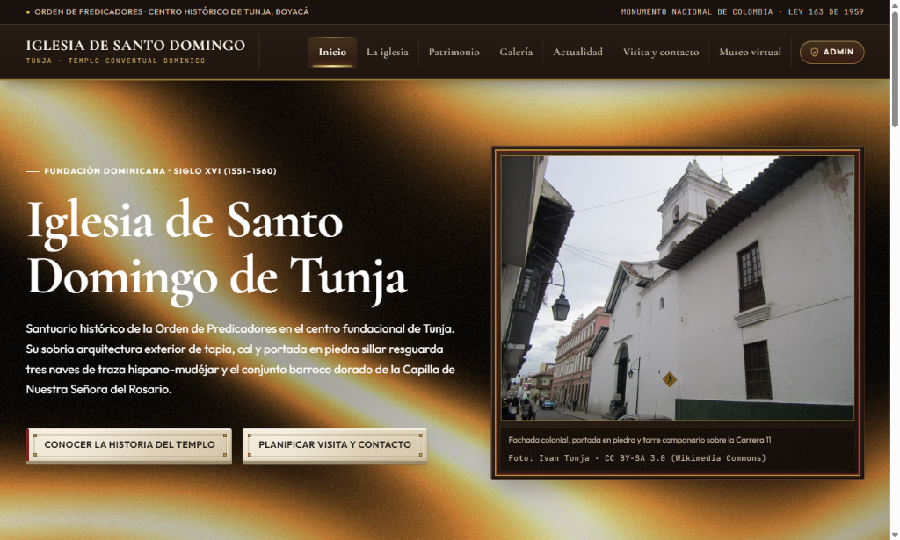
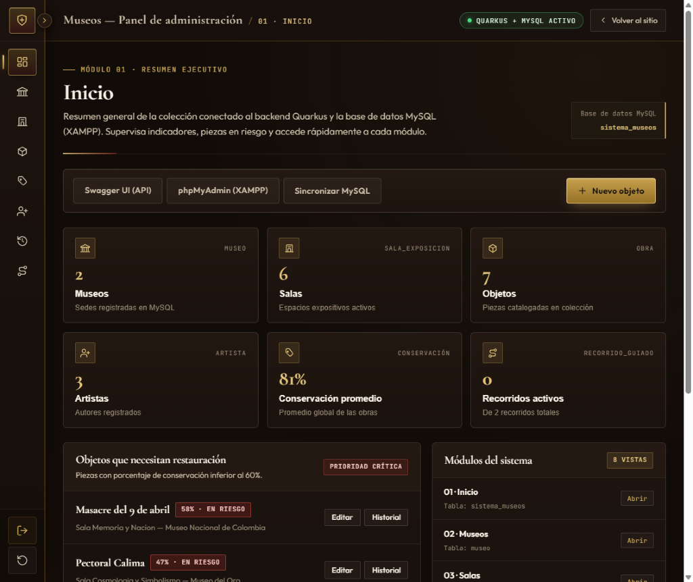
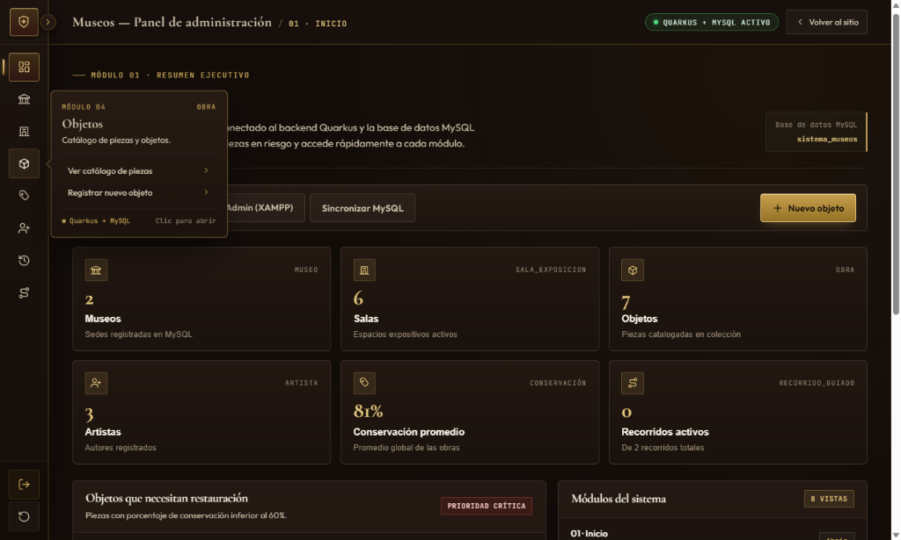
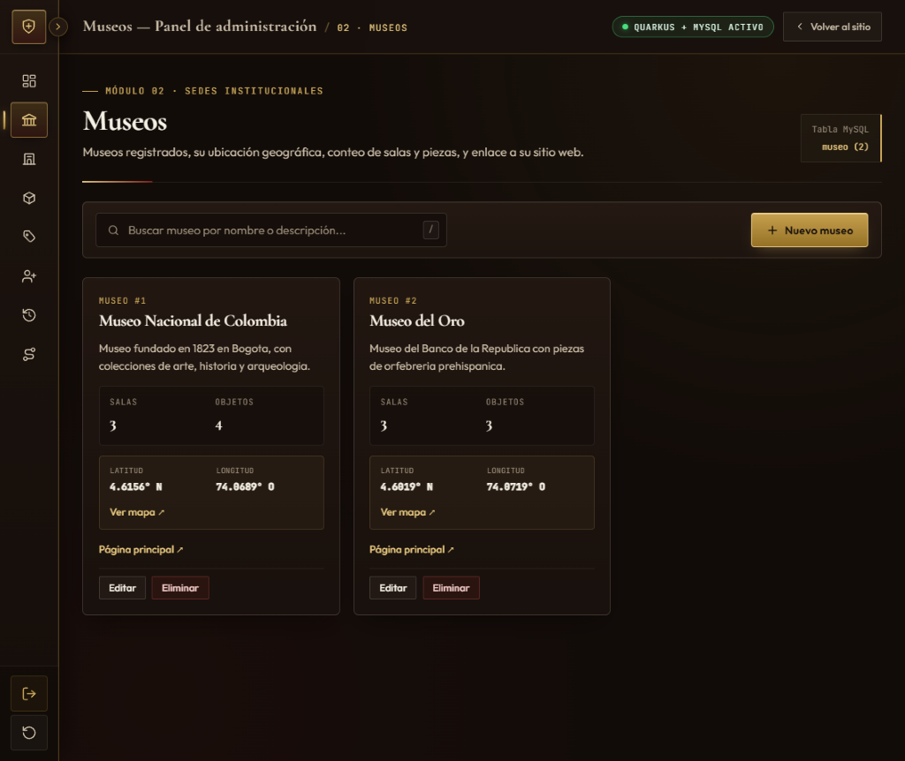
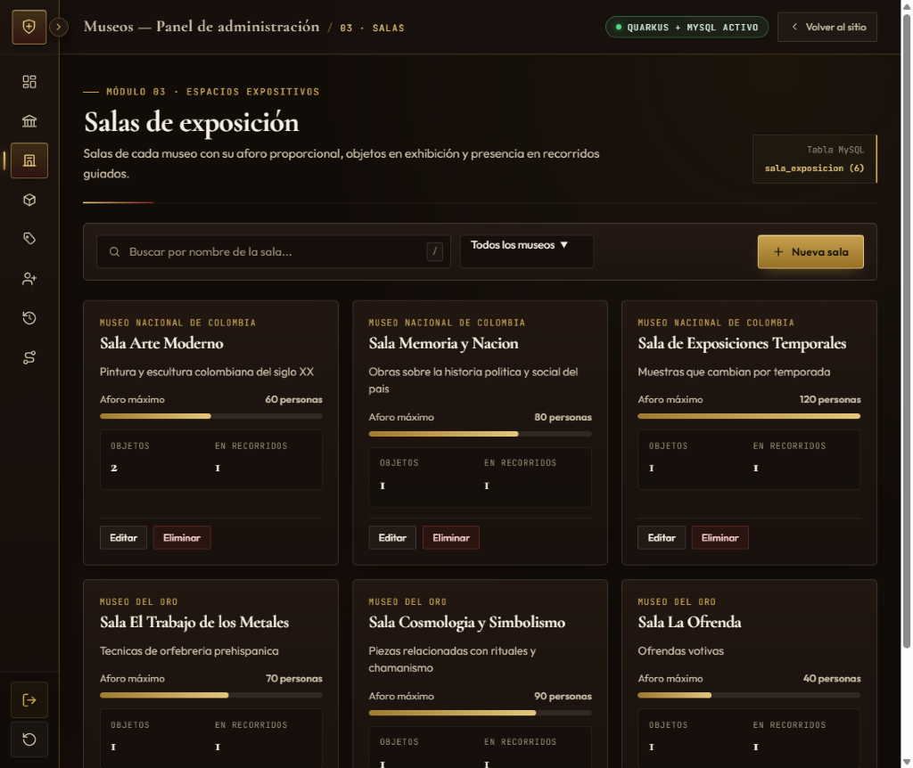
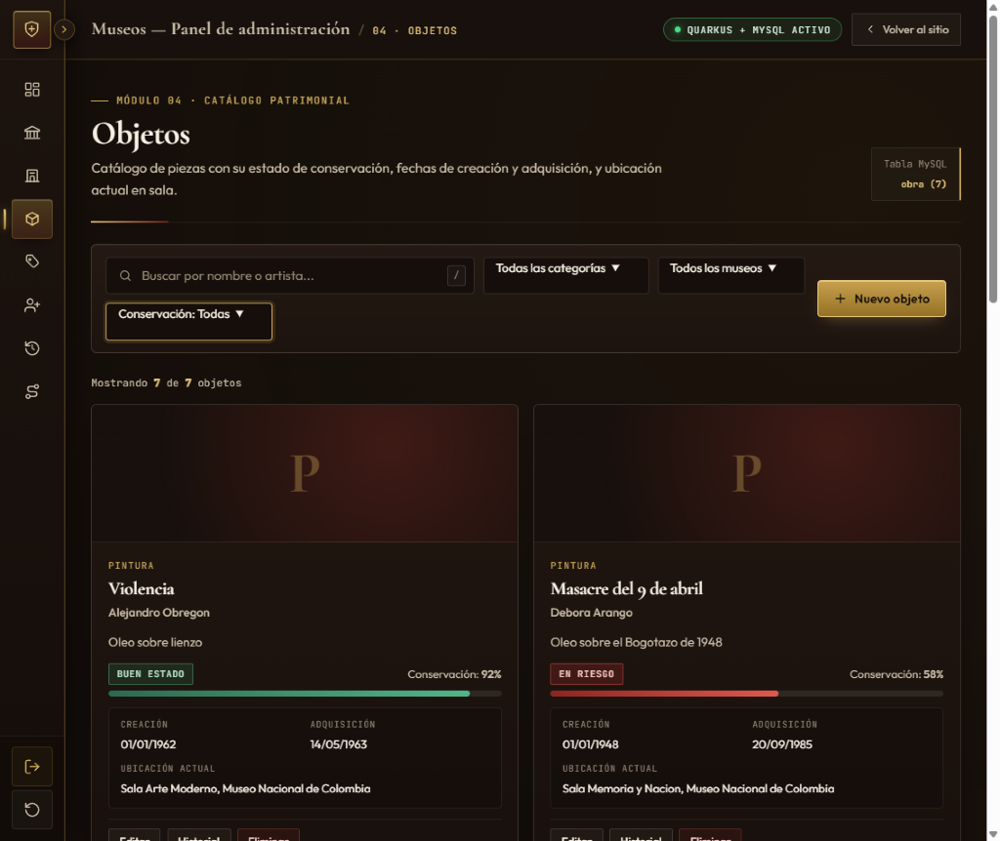
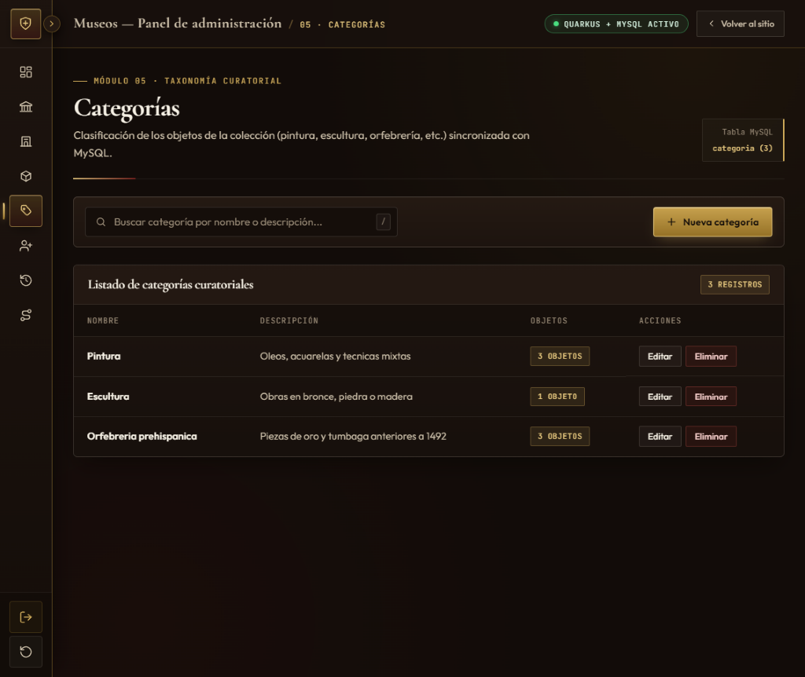
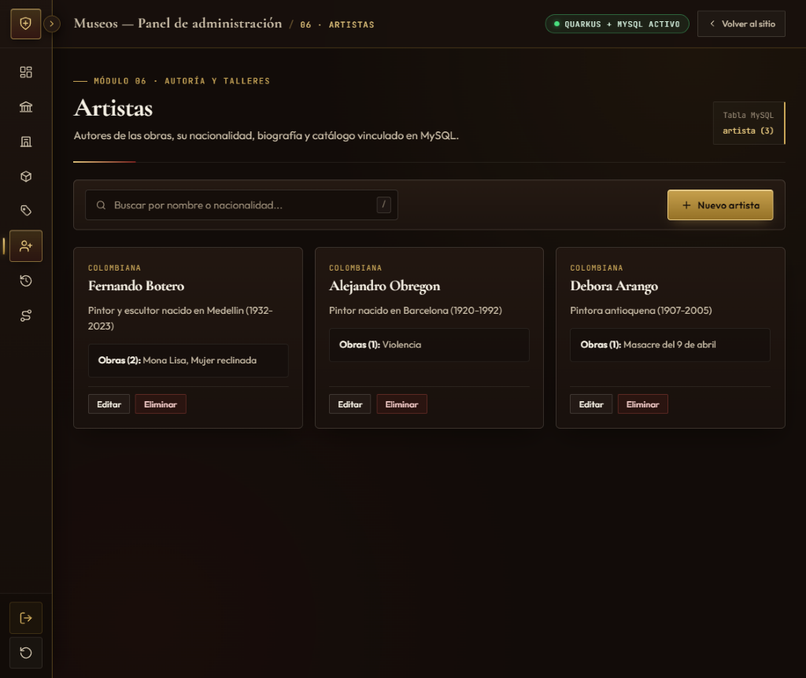
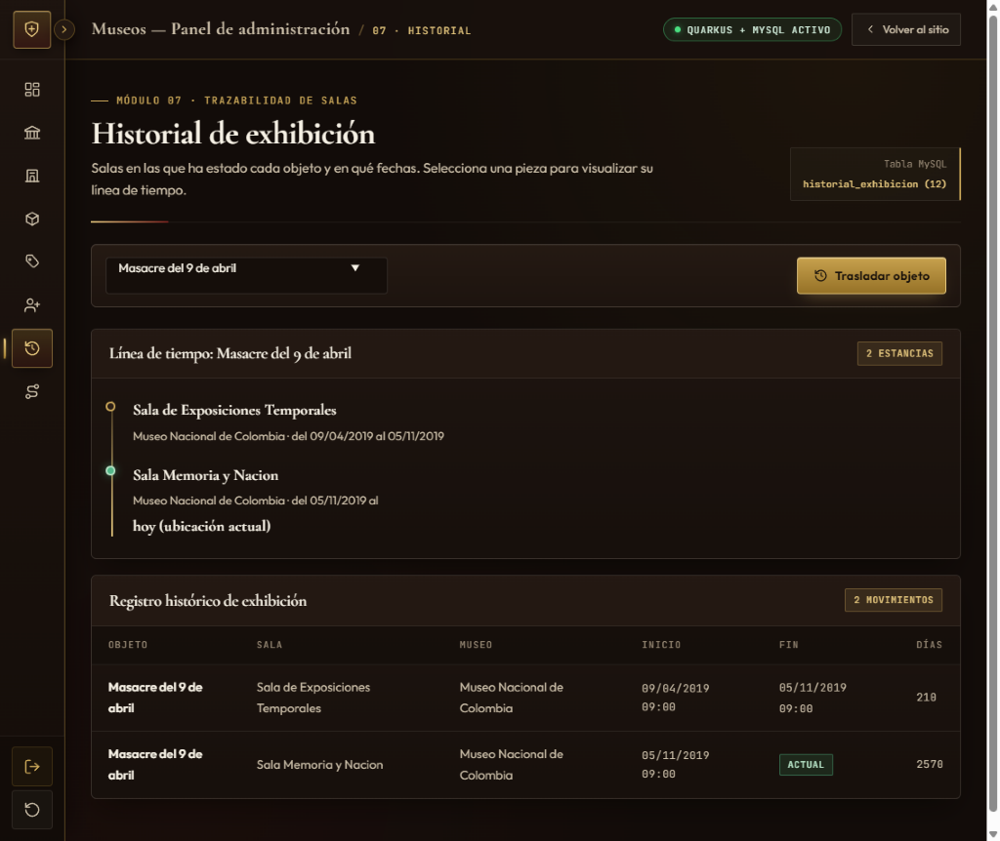
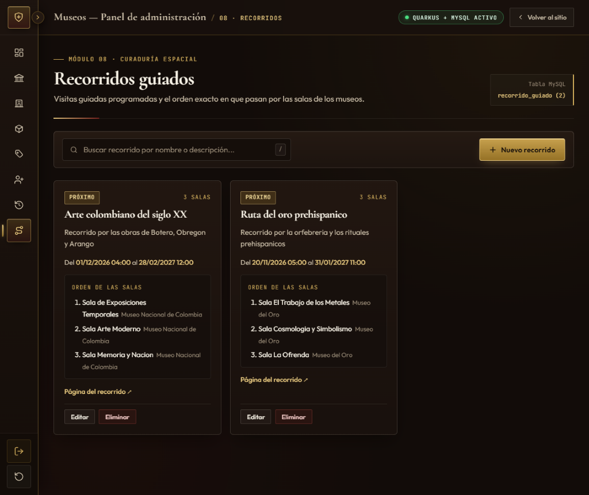

# Sistema de Administración de Museos — Portal Patrimonial, Quarkus y MySQL (XAMPP)

## Descripción general

El **Sistema de Administración de Museos** es una aplicación web y API REST desarrollada con **Quarkus 3.6**, **Java** y **MySQL / MariaDB (XAMPP)** que integra dos entornos dentro de una misma arquitectura:

1. **Portal Institucional y Patrimonial (Iglesia de Santo Domingo de Tunja):** sitio web en **HTML5 + CSS3 modular + JavaScript Vanilla** con diseño editorial en cedro oscuro, pan de oro y rojo almagre, galería interactiva y acceso directo al área administrativa desde el botón **Admin** en la barra de navegación.
2. **Panel de Administración de Museos (`/admin.html`):** interfaz oscura coherente con el sistema de diseño del portal, equipada con un **Sidebar tipo Icon Rail con Hover Flyouts**, 8 módulos independientes, formularios modales CRUD, filtros en tiempo real, línea de tiempo de traslados y sincronización en vivo con **Quarkus (`/api/datos`)** y **MySQL (`sistema_museos` en XAMPP)**.

Todos los cambios realizados desde la interfaz web (altas, ediciones, eliminaciones, traslados de obras y orden de recorridos) se persisten directamente en las tablas de **MySQL** y pueden consultarse de inmediato en **phpMyAdmin (XAMPP)** y **Swagger UI**.

---

## Objetivo del proyecto

El objetivo principal del proyecto es construir un sistema integral y modular que centralice la gestión museográfica de museos, salas de exposición, catálogo de obras, artistas, categorías, historial de exhibición y recorridos guiados, aplicando principios de **Programación Orientada a Objetos (POO)**, arquitectura RESTful en **Quarkus** y persistencia relacional en **MySQL (XAMPP)**.

El sistema simula una plataforma institucional real donde tanto el visitante (portal patrimonial) como el curador/administrador (panel administrativo) disponen de una experiencia visual coherente, clara y conectada a base de datos.

---

## Funcionalidades principales

### Portal Institucional y Acceso Administrativo

- Sitio multipágina (`index.html`, `iglesia.html`, `patrimonio.html`, `galeria.html`, `actualidad.html`, `visita.html`, `museo.html`) servido directamente por Quarkus en `http://localhost:8080`.
- Botón diferenciado **Admin** en la esquina superior derecha de la barra de navegación para ingresar al Panel de Administración (`/admin.html`), y acción **Volver al sitio** dentro del panel para regresar al portal.

### Panel de Administración (8 módulos con Sidebar *Icon Rail + Hover Flyouts*)

- **Inicio (Dashboard):** muestra 6 indicadores en tiempo real (Museos, Salas, Objetos, Artistas, Conservación promedio `%` y Recorridos activos), lista prioritaria de **Objetos que necesitan restauración (`< 60%`)**, indicador en vivo de conexión (`Quarkus + MySQL activo`) y accesos directos a **Swagger UI** y **phpMyAdmin**.
- **Museos:** búsqueda en tiempo real, tarjetas con descripción, conteo de salas y objetos, coordenadas geográficas con enlace directo a **Google Maps**, sitio web oficial y CRUD completo (validando integridad si sus salas están en uso).
- **Salas de exposición:** filtro por museo, buscador por nombre, barra proporcional de aforo máximo, conteo de obras y recorridos, y CRUD con validación de nombres duplicados dentro del mismo museo.
- **Objetos (Catálogo de piezas):** búsqueda por nombre o artista, filtros combinados por **Categoría**, **Museo** y **Estado de conservación**, barras de conservación por color, fechas de creación/adquisición validadas, ubicación actual, acceso directo al historial de la pieza y registro automático en historial al crear o cambiar de sala.
- **Categorías:** búsqueda en tiempo real y tabla curatorial con conteo de objetos asociados, validación de nombres únicos y protección contra eliminación si posee obras vinculadas.
- **Artistas:** búsqueda por nombre o nacionalidad, biografía, listado de obras asociadas y gestión CRUD (al eliminar un artista, sus obras pasan automáticamente a **Anónimo**, respetando `ON DELETE SET NULL`).
- **Historial de exhibición:** filtro por objeto, **línea de tiempo visual** por pieza, tabla cronológica con cálculo de días de permanencia y modal **Trasladar objeto** (cierra la estancia anterior y abre una nueva validando sala destino y fecha).
- **Recorridos guiados:** cálculo automático de estado (**Próximo**, **Activo**, **Finalizado**), visualización de itinerarios ordenados y modal interactivo para agregar, subir (`↑`), bajar (`↓`) y quitar (`×`) salas en el recorrido.
- **Restaurar datos de ejemplo:** botón en el pie del sidebar para restablecer la semilla inicial en la interfaz y en MySQL.

### Estados de Conservación

Cada obra posee un porcentaje de conservación (`0` a `100`) a partir del cual el sistema clasifica automáticamente su estado y recomendación técnica:

| Rango | Estado | Recomendación |
|---|---|---|
| `80% – 100%` | **Buen estado / Óptimo** | Puede seguir en exhibición normalmente |
| `60% – 79%` | **Regular** | Programar una revisión en los próximos meses |
| `0% – 59%` | **En riesgo / Crítico** | Retirar a restauración lo antes posible |

### Reportes Administrativos (API REST)

El backend en Quarkus expone reportes consolidados en JSON consultables desde **Swagger UI**:

- Listado detallado de obras con artista, categoría, sala actual, museo y conservación (`/reportes/obras`).
- Promedio de conservación por sala (`/reportes/conservacion`).
- Agrupación de obras por estado de conservación (`/reportes/estados`).
- Reporte general polimórfico mediante la interfaz `Reportable` (`/reportes/general`).

---

## Tecnologías utilizadas

| Tecnología | Uso |
|---|---|
| Java 17 / 21 | Lenguaje principal del backend |
| Quarkus 3.6.0 | Framework principal (API REST + servidor web estático) |
| RESTEasy Reactive (JAX-RS) | Exposición de servicios RESTful con Jackson JSON |
| Quarkus ArC (CDI) | Inyección de dependencias (`@ApplicationScoped`) |
| SmallRye OpenAPI / Swagger UI | Documentación y pruebas interactivas de la API |
| MySQL / MariaDB (XAMPP) | Motor de base de datos relacional (`sistema_museos`) |
| HTML5 + CSS3 + JavaScript Vanilla | Portal institucional y Panel Admin modular sin frameworks pesados |
| Maven | Gestión del proyecto, compilación y ejecución |
| Visual Studio Code | Editor de código utilizado |
| GitHub | Publicación y control de versiones |

---

## Librerías y dependencias principales

El proyecto utiliza Maven para administrar sus dependencias:

- `quarkus-resteasy-reactive-jackson`
- `quarkus-arc`
- `quarkus-smallrye-openapi`
- `mysql-connector-j` (MySQL JDBC Driver `8.3.0`)
- `quarkus-maven-plugin`
- `maven-compiler-plugin`

Todas se encuentran configuradas en el archivo:

```text
pom.xml
```

---

## Motor de base de datos

El proyecto utiliza **MySQL / MariaDB (XAMPP)** como motor de base de datos.

Nombre de la base de datos:

```sql
sistema_museos
```

Tablas del esquema relacional:

- `museo` (Museos registrados, coordenadas geográficas y sitio web).
- `sala_exposicion` (Salas asociadas a cada museo y capacidad de aforo).
- `categoria` (Clasificación temática/técnica de las piezas).
- `artista` (Autores, nacionalidad y biografía).
- `obra` (Catálogo de piezas, conservación y relaciones con categoría, artista y sala actual).
- `historial_exhibicion` (Trazabilidad de entradas y salidas de obras por sala).
- `recorrido_guiado` (Recorridos programados con fecha de inicio y fin).
- `detalle_recorrido_sala` (Orden secuencial de salas dentro de cada recorrido).

El script SQL completo con la creación de tablas y datos iniciales de prueba se encuentra en:

```text
database/museo_xampp_mysql.sql
```

---

## Estructura del proyecto

```text
Museo_quarkus/
├── database/
│   └── museo_xampp_mysql.sql
│
├── docs/
│   └── screenshots/
│       ├── portal_inicio.png
│       ├── admin_inicio.png
│       ├── admin_sidebar_flyout.png
│       ├── admin_museos.png
│       ├── admin_salas.png
│       ├── admin_objetos.png
│       ├── admin_categorias.png
│       ├── admin_artistas.png
│       ├── admin_historial.png
│       └── admin_recorridos.png
│
├── src/
│   └── main/
│       ├── java/
│       │   ├── config/
│       │   │   └── ConexionBD.java
│       │   ├── dto/
│       │   │   ├── AgregarSalaRequest.java
│       │   │   ├── CambiarOrdenRequest.java
│       │   │   ├── CrearRecorridoRequest.java
│       │   │   ├── MoverObraRequest.java
│       │   │   ├── RegistrarArtistaRequest.java
│       │   │   ├── RegistrarCategoriaRequest.java
│       │   │   ├── RegistrarMuseoRequest.java
│       │   │   ├── RegistrarObraRequest.java
│       │   │   └── RegistrarSalaRequest.java
│       │   ├── modelo/
│       │   │   ├── Artista.java
│       │   │   ├── Categoria.java
│       │   │   ├── DetalleRecorridoSala.java
│       │   │   ├── EstadoConservacion.java
│       │   │   ├── Fechas.java
│       │   │   ├── HistorialExhibicion.java
│       │   │   ├── Museo.java
│       │   │   ├── Obra.java
│       │   │   ├── RecorridoGuiado.java
│       │   │   ├── Reportable.java
│       │   │   └── SalaExposicion.java
│       │   ├── resource/
│       │   │   ├── ArtistaResource.java
│       │   │   ├── CategoriaResource.java
│       │   │   ├── ErrorMapper.java
│       │   │   ├── EstadoWebResource.java
│       │   │   ├── MuseoResource.java
│       │   │   ├── ObraResource.java
│       │   │   ├── RecorridoResource.java
│       │   │   ├── ReporteResource.java
│       │   │   └── SalaResource.java
│       │   └── servicio/
│       │       └── SistemaMuseoService.java
│       │
│       └── resources/
│           ├── application.properties
│           └── META-INF/
│               └── resources/
│                   ├── index.html
│                   ├── iglesia.html
│                   ├── patrimonio.html
│                   ├── galeria.html
│                   ├── actualidad.html
│                   ├── visita.html
│                   ├── museo.html
│                   ├── admin.html
│                   ├── assets/img/
│                   ├── css/
│                   │   ├── tokens.css
│                   │   ├── base.css
│                   │   ├── layout.css
│                   │   ├── components.css
│                   │   ├── skeuomorphism.css
│                   │   ├── pages.css
│                   │   ├── main.css
│                   │   └── admin.css
│                   └── js/
│                       ├── main.js
│                       ├── chroma-waves.js
│                       ├── scroll-animations.js
│                       ├── gallery-lightbox.js
│                       ├── contact-form.js
│                       └── admin/
│                           ├── admin-datos.js
│                           ├── admin-registry.js
│                           ├── admin-store.js
│                           ├── admin-modals.js
│                           ├── admin-app.js
│                           └── sections/
│                               ├── inicio.js
│                               ├── museos.js
│                               ├── salas.js
│                               ├── objetos.js
│                               ├── categorias.js
│                               ├── artistas.js
│                               ├── historial.js
│                               └── recorridos.js
│
├── iniciar.bat
├── mvn.cmd
├── pom.xml
├── .gitignore
└── README.md
```

---

## Capturas del proyecto

### Portal Institucional y acceso Admin



### Panel de Administración — Inicio (Dashboard)



### Navegación lateral — Icon Rail con Hover Flyout



### Gestión de Museos



### Salas de Exposición



### Catálogo de Objetos y Conservación



### Gestión de Categorías



### Registro de Artistas



### Historial de Exhibición y Línea de Tiempo



### Recorridos Guiados



---

## Endpoints de la API REST

| Módulo | Método y Ruta | Descripción |
|---|---|---|
| **Web / Sync** | `GET /api/datos` | Obtiene el estado completo del sistema desde MySQL (`mysql_conectado`) |
| **Web / Sync** | `PUT /api/datos` | Persiste y sincroniza los cambios del panel web en las 8 tablas de MySQL |
| **Museos** | `GET /museos` | Lista todos los museos registrados |
| **Museos** | `GET /museos/{id}` | Consulta un museo por su identificador |
| **Museos** | `POST /museos` | Registra un nuevo museo |
| **Salas** | `GET /salas` | Lista todas las salas de exposición |
| **Salas** | `GET /salas/{id}` | Consulta una sala por su identificador |
| **Salas** | `POST /salas` | Registra una nueva sala dentro de un museo |
| **Obras** | `GET /obras` | Lista todas las obras registradas |
| **Obras** | `GET /obras/{id}` | Consulta el detalle e historial de una obra |
| **Obras** | `POST /obras` | Registra una nueva obra en una sala |
| **Obras** | `PUT /obras/{id}/mover` | Traslada una obra a otra sala y actualiza su historial |
| **Artistas** | `GET /artistas` | Lista todos los artistas |
| **Artistas** | `GET /artistas/{id}` | Consulta un artista por su identificador |
| **Artistas** | `POST /artistas` | Registra un nuevo artista |
| **Categorías** | `GET /categorias` | Lista todas las categorías |
| **Categorías** | `GET /categorias/{id}` | Consulta una categoría por su identificador |
| **Categorías** | `POST /categorias` | Registra una nueva categoría |
| **Recorridos** | `GET /recorridos` | Lista todos los recorridos guiados |
| **Recorridos** | `GET /recorridos/{id}` | Consulta un recorrido y sus salas en orden |
| **Recorridos** | `POST /recorridos` | Crea un nuevo recorrido guiado |
| **Recorridos** | `POST /recorridos/{id}/salas` | Agrega una sala al final del recorrido |
| **Recorridos** | `PUT /recorridos/{id}/salas/orden` | Cambia la posición de una sala en el recorrido |
| **Recorridos** | `DELETE /recorridos/{id}/salas/{posicion}` | Retira una sala del recorrido según su posición |
| **Reportes** | `GET /reportes/obras` | Resumen general de obras, ubicación y conservación |
| **Reportes** | `GET /reportes/conservacion` | Promedio de porcentaje de conservación por sala |
| **Reportes** | `GET /reportes/estados` | Obras agrupadas por estado (`Óptimo`, `Regular`, `Crítico`) |
| **Reportes** | `GET /reportes/general` | Reporte polimórfico de museos, obras y recorridos |

---

## Requisitos previos

Antes de ejecutar el proyecto, se recomienda tener instalado:

- **Java JDK 17** o superior (probado con JDK 21).
- **Apache Maven 3.9+**.
- **XAMPP** (con **MySQL / MariaDB** y **Apache** para **phpMyAdmin**).
- Navegador web moderno y Visual Studio Code (opcional).

---

## Cómo ejecutar el proyecto

### 1. Descargar o clonar el repositorio

```bash
git clone https://github.com/Jeizxon/Museo_quarkus.git
cd Museo_quarkus
```

También se puede descargar el repositorio como archivo `.zip` desde GitHub y descomprimirlo.

---

### 2. Iniciar MySQL y Apache en XAMPP

Abrir **XAMPP Control Panel** e iniciar:

- **Apache** (necesario para abrir phpMyAdmin).
- **MySQL** (puerto `3306`, motor donde se guardarán los datos).

---

### 3. Crear la base de datos e importar el script SQL

1. Abrir **phpMyAdmin** en `http://localhost/phpmyadmin`.
2. Ir a la pestaña **Importar** (o abrir la pestaña **SQL**).
3. Seleccionar el archivo:

```text
database/museo_xampp_mysql.sql
```

4. Ejecutar la importación. Esto creará automáticamente la base de datos `sistema_museos`, las 8 tablas relacionales y los registros iniciales de prueba.

---

### 4. Verificar la configuración de conexión a MySQL

El archivo de conexión JDBC se encuentra en:

```text
src/main/java/config/ConexionBD.java
```

Configuración por defecto (compatible con XAMPP estándar):

```java
jdbc:mysql://localhost:3306/sistema_museos?useSSL=false&allowPublicKeyRetrieval=true&serverTimezone=UTC
Usuario: root
Contraseña: "" (vacía)
```

También puede personalizarse sin editar el código mediante las variables de entorno:

```text
MUSEO_DB_URL
MUSEO_DB_USER
MUSEO_DB_PASSWORD
```

---

### 5. Ejecutar el servidor Quarkus

Desde la carpeta raíz del proyecto, puedes iniciar el sistema de dos maneras:

- **Opción rápida en Windows:** hacer doble clic en `iniciar.bat`.
- **Opción desde terminal:**

```bash
mvn quarkus:dev
```

---

### 6. Abrir la aplicación en el navegador

Una vez iniciado Quarkus en el puerto `8080`, accede a:

| Servicio | URL |
|---|---|
| **Portal Principal** | `http://localhost:8080` |
| **Panel de Administración** | `http://localhost:8080/admin.html` |
| **Swagger UI (API REST)** | `http://localhost:8080/swagger-ui` |
| **phpMyAdmin (XAMPP)** | `http://localhost/phpmyadmin` |

---

## Notas importantes

- Para que los cambios del Panel de Administración se reflejen en las tablas de **phpMyAdmin**, el módulo **MySQL** en XAMPP debe estar encendido; cuando esté activo, la barra superior del panel mostrará el indicador verde **`Quarkus + MySQL activo`**.
- Si MySQL está temporalmente apagado, el panel lo avisará con el indicador **`Quarkus activo · MySQL apagado`** y conservará los cambios en memoria/respaldo local hasta que MySQL vuelva a iniciarse.
- Las capturas de pantalla se almacenan en `docs/screenshots/` para renderizarse automáticamente en GitHub.
- El botón **Restaurar datos de ejemplo** al pie del sidebar permite volver rápidamente al estado inicial del script SQL.

---

## Posibles errores comunes

### El indicador muestra "Quarkus activo · MySQL apagado"

Verificar:

- Que **MySQL** esté iniciado en **XAMPP Control Panel** (puerto `3306`).
- Que la base de datos `sistema_museos` haya sido importada desde `database/museo_xampp_mysql.sql`.
- Que el usuario y contraseña en `src/main/java/config/ConexionBD.java` coincidan con tu instalación de XAMPP (`root` sin contraseña por defecto).

### Puerto 8080 en uso al iniciar Quarkus

Cerrar cualquier instancia previa de Quarkus o proceso Java que esté usando el puerto `8080`, o cambiar `quarkus.http.port` en `src/main/resources/application.properties`.

### Maven no se reconoce como comando

Verificar que `mvn` esté agregado al `PATH` del sistema o ejecutar el proyecto usando `iniciar.bat` / `mvn.cmd`.

---

## Estado del proyecto

Proyecto académico funcional.

El portal patrimonial y el Panel de Administración se encuentran completamente integrados en **Quarkus** y conectados a **MySQL (XAMPP)**, permitiendo gestionar en vivo museos, salas, obras, categorías, artistas, historial de exhibición y recorridos guiados.
